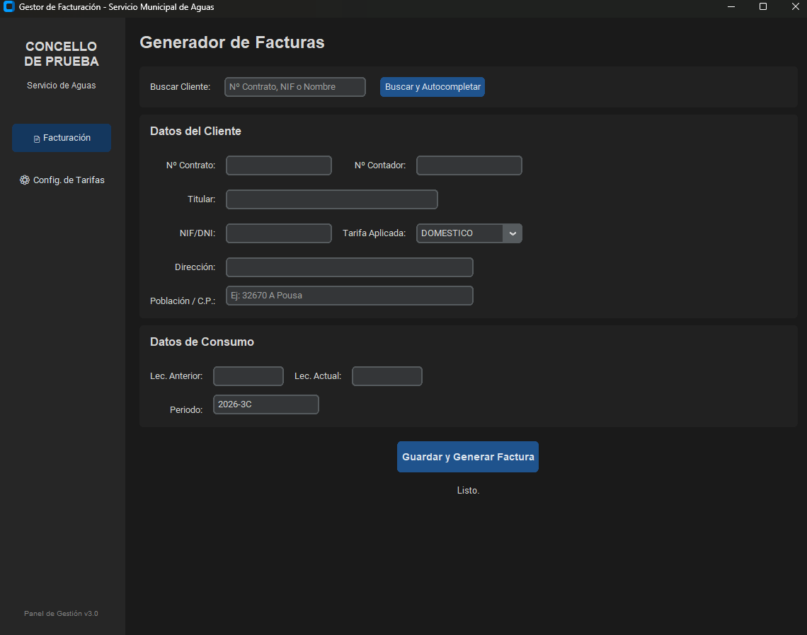
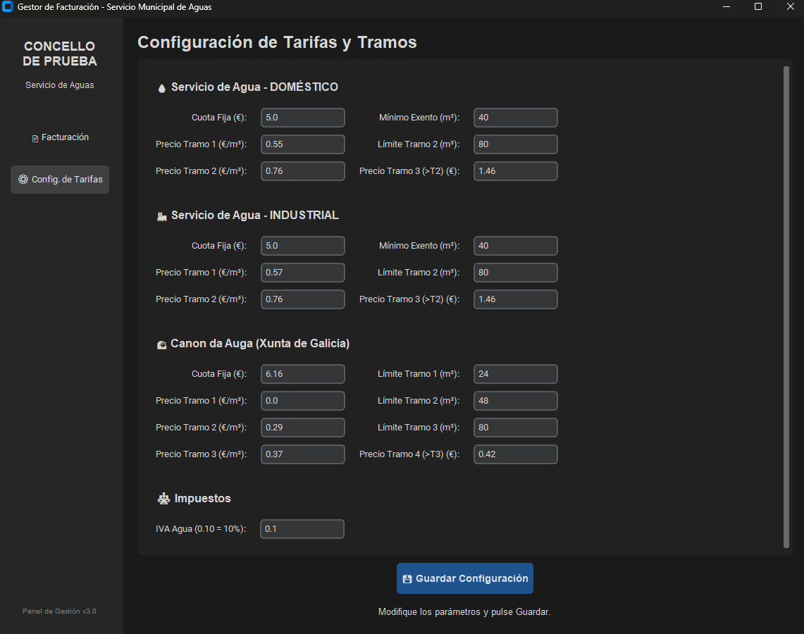
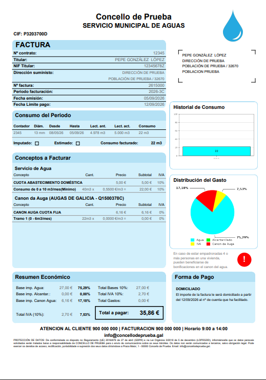

# 💧 Water Billing Management System

Aplicación de escritorio Full-Stack desarrollada a medida para la gestión de clientes y la generación de facturas del servicio de aguas de una administración local.

El software sustituye los procesos manuales por un entorno digital unificado: gestiona la base de datos de clientes, las tarifas configurables y la generación de facturas en PDF con el desglose del consumo.

*Nota: este repositorio solo contiene datos ficticios. El nombre del concello, el CIF, los teléfonos, el correo y las direcciones del código son de ejemplo, por motivos de protección de datos (RGPD).*

## 🚀 Características Principales (Features)

*   **Interfaz de Configuración Dinámica (JSON):** Toda la lógica de precios (tramos de consumo, cuotas fijas, impuestos y cánones autonómicos) está abstraída en un archivo `config_tarifas.json`. La UI incluye un panel (`CustomTkinter`) que permite al personal administrativo modificar los precios visualmente sin interactuar con el código fuente.
*   **Base de Datos (`SQLite`):** Sistema de guardado automático. Al registrar una factura, el cliente persiste en la base de datos. Para la siguiente factura, el sistema autocompleta los datos (Nombre, Dirección, Tarifa y última lectura) simplemente buscando el DNI, el Nº de Contrato o el nombre.
*   **Cálculo Automatizado de Periodos (`datetime`):** El algoritmo lee el reloj del sistema para deducir el cuatrimestre de facturación en curso y fijar la fecha límite de pago (7 días desde la emisión).
*   **Numeración correlativa de facturas:** Cada factura recibe un número único (año + identificador correlativo), de modo que dos facturas nunca comparten número ni se sobrescriben sus PDF.
*   **Generador de PDFs (`fpdf2` & `Matplotlib`):** Maquetación de la factura con el desglose económico por responsabilidades (tarifa local y canon autonómico). Incrusta un gráfico de barras con el histórico de consumo y un gráfico sectorial (*Pie Chart*) con la distribución del gasto.

## 📸 Interfaz y Resultados (Screenshots)

### 1. Interfaz Gráfica y Gestión de Tarifas



### 2. Factura Generada


## 🛠️ Tecnologías y Arquitectura
*   **Lenguaje:** Python
*   **Base de Datos:** SQLite3
*   **Frontend (GUI):** CustomTkinter
*   **Procesamiento y Renderizado:** fpdf2, Matplotlib, NumPy

## ⚙️ Instalación y Uso (How to run)

1. Clona este repositorio en tu máquina local:
   ```bash
   git clone https://github.com/adriglezdevesa/Water-Billing-Management-System.git
   cd Water-Billing-Management-System
   ```

2. Instala las dependencias necesarias:
   ```bash
   pip install -r requirements.txt
   ```
   *(En Linux puede hacer falta instalar también Tkinter: `sudo apt install python3-tk`.)*

3. Crea la base de datos (las tablas de clientes y facturas):
   ```bash
   python src/base_datos.py
   ```

4. Ejecuta la aplicación:
   ```bash
   python src/interfaz.py
   ```

Las facturas en PDF se guardan en la carpeta `informes/`. La primera vez, los clientes se dan de alta rellenando sus datos a mano al generar su primera factura.

## ⚠️ Limitaciones conocidas

*   **Datos y tarifas de ejemplo:** los precios de `config_tarifas.json` son un punto de partida. Antes de usarlo en un caso real hay que revisarlos con la ordenanza vigente.
*   **Consumo mínimo:** si el consumo del periodo es inferior al mínimo configurado (40 m³ por cuatrimestre en el ejemplo), se cobra el mínimo, aunque la factura muestre el consumo real medido.
*   **Valores fijos en el código:** el diámetro del contador (13 mm), el rango de fechas del periodo (120 días hacia atrás), el plazo de pago (7 días), la forma de pago (domiciliado) y el alcantarillado (0 €) no son configurables desde la interfaz.
*   **Sin control de duplicados:** generar dos veces la factura de un mismo cliente y periodo crea dos facturas distintas, cada una con su número.
*   **Sin validación de coherencia en las tarifas:** el panel de configuración comprueba que los valores sean números, pero no que los límites de los tramos tengan sentido entre sí.

---

**Autor:** Adrián González Devesa
